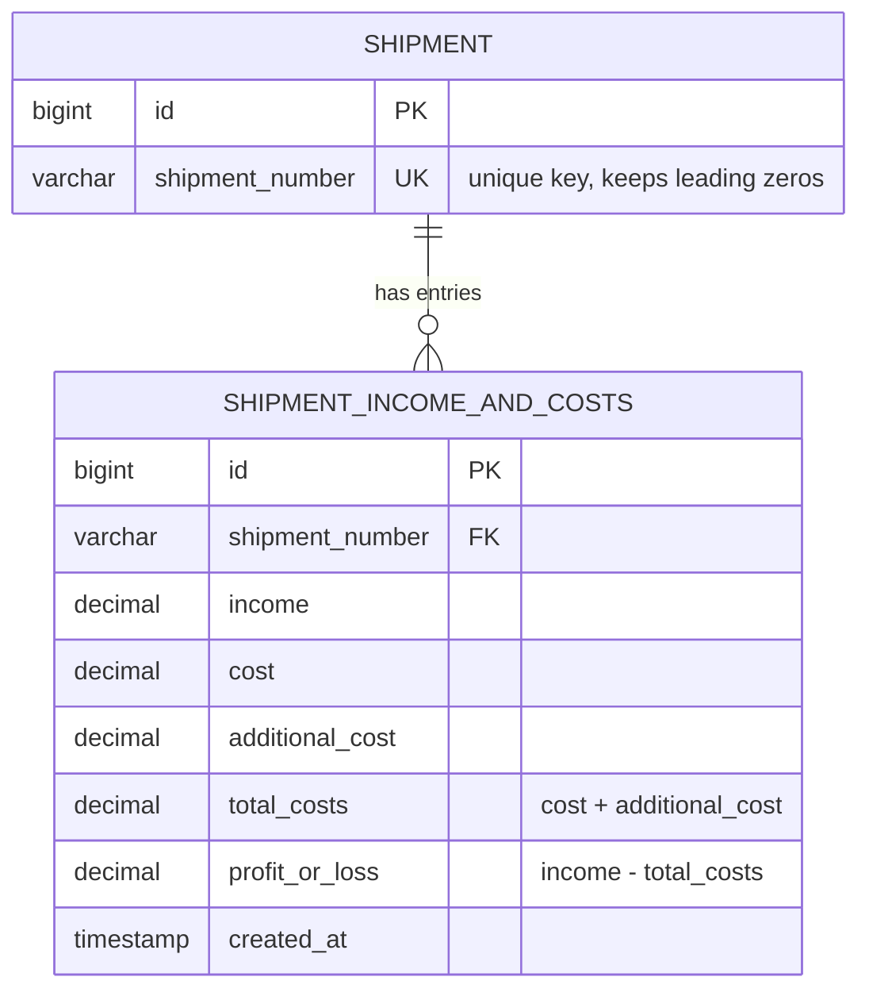

# Profit and Loss

Logistics Income and Cost Evaluation System, a solution to evaluate income and costs generated during the main carriage in a logistics company.

Income and costs are recorded as entries of a shipment. The profit or loss of the shipment is the sum of all its entries.

The project contais a REST API using Spring Boot and a web page using Angular.

## Prerequisites

| Tool              | Version                                                                                                    |
|-------------------|------------------------------------------------------------------------------------------------------------|
| Java (JDK)        | 17                                                                                                         |
| Maven             | 3.9.3. No installation needed: the project ships the Maven Wrapper (`mvnw`), which downloads this version. |
| Node.js           | 21.0.0. Only needed to work on the frontend with `npm start`; the Maven build downloads it automatically.  |
| Docker (Optional) | To run everything in a container, without the tools above.                                                 |                                                 |

## Running the application


### Docker container (requires docker installed)

```
docker-compose up
```
Open `http://localhost:8080`.

### API and UI

```bash
./mvnw spring-boot:run -Pfrontend
```

Open `http://localhost:8080`. The page for a shipment is `http://localhost:8080/#/shipments/0001/calculate-profit`.

The `frontend` Maven profile downloads Node 21.0.0 into `frontend/node`, installs the npm dependencies and builds the Angular app into the Spring Boot static resources. The first run takes longer; the next runs reuse what was already downloaded.

### API only

```bash
./mvnw spring-boot:run
```

On Windows, use `mvnw.cmd`. To use another port:

```bash
./mvnw spring-boot:run -Dspring-boot.run.arguments=--server.port=9090
```

### Frontend in development mode

With the API running on `http://localhost:8080`:

```bash
cd frontend
nvm use
npm install
npm start
```

## Database

The project uses an **in-memory H2** database. The schema and the initial data are created by **Liquibase** on every start. Data is lost when the application stops.

## Data model


### Initial data

- shipments 0001, 0002, 0003, 0004 and 0005;

## API

### Calculate profit or loss

`POST /api/shipments/{shipmentNumber}/profit-loss`

```bash
curl -X POST http://localhost:8080/api/shipments/0001/profit-loss \
  -H "Content-Type: application/json" \
  -d '{"income": 230.5, "cost": 200, "additionalCost": 0}'
```

| Field | Required | Rule |
|---|---|---|
| `income` | yes | zero or more, up to 15 integer digits and 2 decimal places |
| `cost` | yes | zero or more, up to 15 integer digits and 2 decimal places |
| `additionalCost` | no (defaults to 0) | zero or more, up to 15 integer digits and 2 decimal places |

At least one of the three values must be greater than zero.

Response `201 Created`:

```json
{
  "id": 3,
  "shipmentNumber": "0001",
  "income": 230.50,
  "totalCosts": 200.00,
  "profitOrLoss": 30.50,
  "createdAt": "2026-11-12T10:18:29.750836Z"
}
```

A loss is returned as a negative `profitOrLoss`.

### Shipment profit or loss

`GET /api/shipments/{shipmentNumber}/profit-loss`

```bash
curl http://localhost:8080/api/shipments/0001/profit-loss
```

Returns `200 OK` with the totals of the shipment, summed from all entries, and the entries in descending order:

```json
{
  "shipmentNumber": "0001",
  "totalIncome": 1500.00,
  "totalCosts": 1250.00,
  "profitOrLoss": 250.00,
  "entries": [
    { "id": 3, "shipmentNumber": "0001", "income": 0.00, "totalCosts": 150.00, "profitOrLoss": -150.00, "createdAt": "2026-11-12T09:00:00Z" },
    { "id": 2, "shipmentNumber": "0001", "income": 500.00, "totalCosts": 900.00, "profitOrLoss": -400.00, "createdAt": "2026-11-11T09:00:00Z" },
    { "id": 1, "shipmentNumber": "0001", "income": 1000.00, "totalCosts": 200.00, "profitOrLoss": 800.00, "createdAt": "2026-11-10T09:00:00Z" }
  ]
}
```

A shipment without entries returns zero totals and an empty `entries` list.

### Errors

Errors follow [RFC 7807 (Problem Details)](https://www.rfc-editor.org/rfc/rfc7807):

| Status | When |
|---|---|
| `400 Bad Request` | invalid data or malformed JSON; field errors are listed in `errors` |
| `404 Not Found` | unknown shipment |
| `500 Internal Server Error` | unexpected error; it is logged and the user can retry |

Example of a `400`:

```json
{
  "type": "about:blank",
  "title": "Invalid data",
  "status": 400,
  "detail": "Request validation failed",
  "instance": "/api/shipments/0001/profit-loss",
  "errors": {
    "income": "Income must not be negative"
  }
}
```

## Running Tests

Backend. Jacoco generates the coverage report in `target/site/jacoco/index.html`

```bash
# test phase executes the minimum coverage check of 80% of lines
./mvnw test 
# to individually check the minimum coverage
./mvnw verify 
```


Frontend. The coverage report is generated in `frontend/coverage/frontend/index.html`.

```bash
cd frontend
npm test -- --watch=false --browsers=ChromeHeadless --code-coverage
```

## Project structure

### Backend

Layered design with practical domain modeling:

| Path | Content |
|---|---|
| `domain/model` | Entities holding the persisted state (`ShipmentIncomeAndCosts`, `Shipment`) and the `ShipmentNumber` value object |
| `domain/service` | `ProfitLossCalculator`: business rules of the calculation (domain service) |
| `domain/repository` | Repository interfaces (no Spring dependency) |
| `domain/exception` | Domain exceptions |
| `application` | `ShipmentIncomeAndCostsService` (entries and profit or loss), `ShipmentService` (list of shipments), DTOs (records) and mappers |
| `infrastructure/persistence` | Repository implementations (delegating to Spring Data JPA) and the JPA converter of `ShipmentNumber` |
| `infrastructure/config` | Registers the domain services as Spring beans |
| `api` | REST controller and error handling |


### Frontend

| Path | Content |
|---|---|
| `core/models` | API contracts (entry request and response, shipment profit or loss, problem details) |
| `core/services` | `ProfitLossService` (entries and profit or loss), `ShipmentService` (list of shipments) |
| `features/profit-loss/profit-loss-page` | Page: shipment list and route, API calls, entry form and messages |
| `features/profit-loss/entries-table` | Table of the entries with the shipment total in the footer |
| `features/profit-loss/amount-field` | Amount input for reactive forms: validates its own format, shows its error and turns the typed text (`230,5`) into a number (`230.5`) |
| `features/profit-loss/entry-form.validators.ts` | Form rules (at least one amount greater than zero, shipment number not blank) |
| `app.component.*` | Layout: top bar with the logo and side menu |
| `app.routes.ts` | Routes (lazy-loaded page) |
| `app.config.ts` | Providers (router with hash URLs and route-to-input binding, HTTP, animations) |


## Technical decisions


### Backend

- Spring Boot 3.1.5, Java 17, Maven 3.9.3, mentioned as required versions. 
- Liquibase manages the schema and Hibernate only checks that the entities match it.
- DDD Layered architecture. Domain entities hold no business rules, only the stored state. The rules are in the ProfitLossCalculator domain service.
- Domain entities are also the JPA entities. A practical choice given the size of the domain: at the cost of the domain depending on `jakarta.persistence`.


### Frontend

- Same repository, built by a Maven profile. `./mvnw spring-boot:run -Pfrontend` builds and serves everything on one port, with no Node installation required.
- Angular Material for components, Bootstrap for layout. Form fields, button, table, sorting and notifications are Material components. Bootstrap and Bootstrap Icons are used only for layout, iconography and utility styles.
- Custom decimal value input field component `AmountFieldComponent`
- Custom Table compoment for Income & Outcome entries `EntriesTableComponent`
- `sass` lib version overriden. `Sass` lib version bundled with Angular 17.1.0 crashes on Node 21.0.0; `package.json` overrides it to `1.71.1`.

